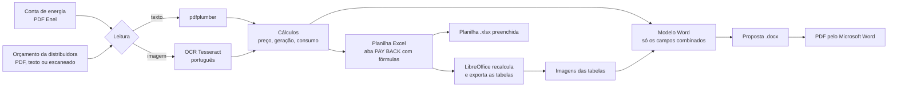
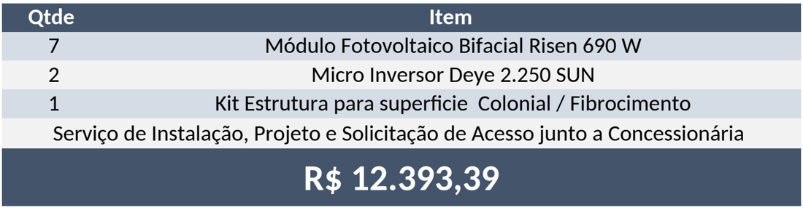
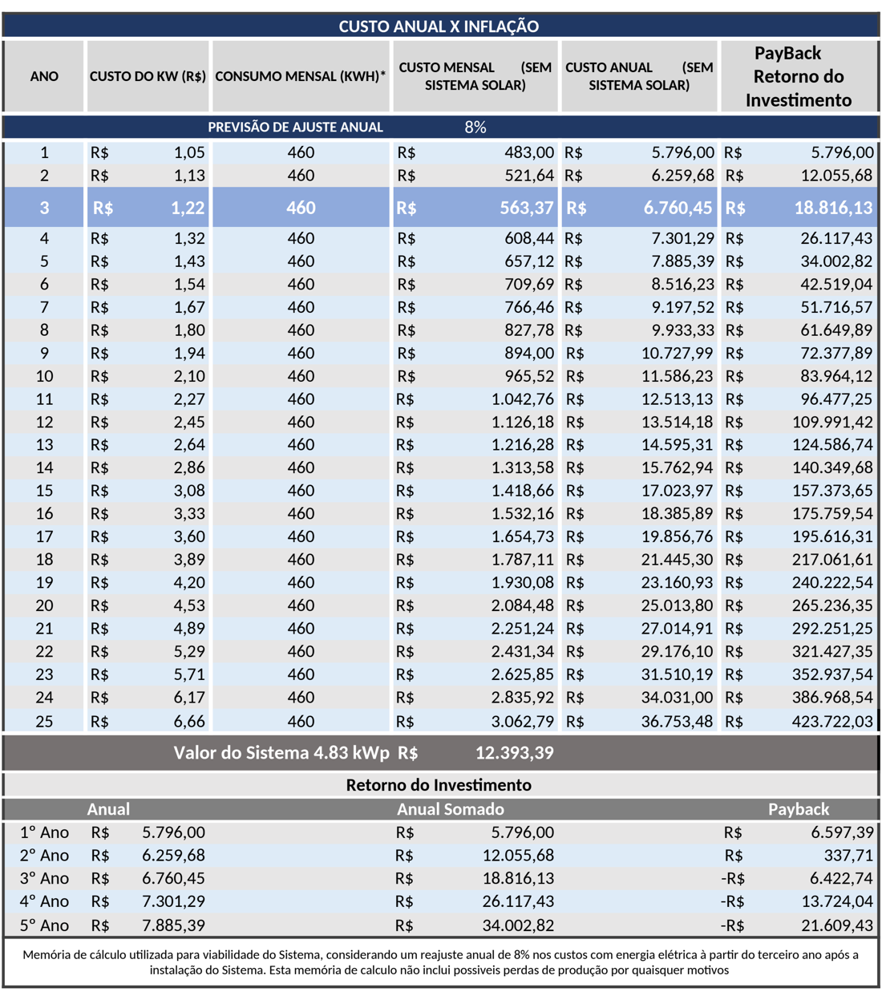

<p align="center">
  
</p>

<h1 align="center">Gerador de Propostas — Solar In Focco</h1>

<p align="center">
  O gerador lê a conta de energia do cliente e o orçamento da distribuidora de kits. Com esses dados, monta a <b>proposta comercial de energia solar</b> no modelo oficial da empresa, com tabela de payback e PDF prontos, em poucos segundos.
</p>

<p align="center">
  
  
  
</p>

---

## Índice

1. [O problema](#o-problema)
2. [O que o sistema faz](#o-que-o-sistema-faz)
3. [Como funciona](#como-funciona)
4. [Campos alterados no modelo](#campos-alterados-no-modelo)
5. [Regras de cálculo](#regras-de-cálculo)
6. [Instalação (usuário final)](#instalação-usuário-final)
7. [Como usar no dia a dia](#como-usar-no-dia-a-dia)
8. [Uso por linha de comando](#uso-por-linha-de-comando)
9. [Configuração (`config.json`)](#configuração-configjson)
10. [Estrutura do projeto](#estrutura-do-projeto)
11. [Detalhes técnicos](#detalhes-técnicos)
12. [Problemas comuns](#problemas-comuns)
13. [Limitações conhecidas e próximos passos](#limitações-conhecidas-e-próximos-passos)

---

## O problema

Cada proposta da Solar In Focco era montada à mão. O processo era assim:

- copiar os dados do cliente da conta da Enel;
- abrir o orçamento da distribuidora (BelEnergy) e calcular o preço de venda;
- atualizar a planilha de payback e colar a tabela como imagem no Word;
- trocar potência, geração, quantidade de painéis e outros dados em várias páginas.

Isso levava tempo e abria espaço para erro: valor antigo esquecido numa página, kWp diferente entre a capa e a tabela, data desatualizada. O objetivo do projeto foi automatizar tudo, **sem mudar o visual do modelo**, para qualquer pessoa usar, mesmo quem tem pouco contato com tecnologia.

## O que o sistema faz

- 📄 **Lê a conta de energia** (PDF da Enel, paga por débito automático ou por boleto): nome, endereço, município, classe, tipo de ligação, histórico de 13 meses, tarifa e valores.
- 🧾 **Lê o orçamento da distribuidora**, mesmo **escaneado** (usa OCR em português): potência, módulos, inversores, estrutura e valor total.
- 💰 **Calcula o preço de venda**: valor da distribuidora **+ 50%** (configurável).
- 📈 **Calcula o payback de 25 anos** na **planilha Excel original, com as fórmulas**. A linha em destaque acompanha o ano em que o investimento se paga.
- 📝 **Preenche o modelo Word** trocando **apenas os campos combinados** e preservando fontes, cores, imagens, caixas de texto e rodapés.
- 🖨️ **Gera o PDF pelo próprio Microsoft Word**, com a diagramação idêntica ao modelo.
- ⚠️ **Mostra avisos** do que precisa ser conferido, como nome diferente entre conta e orçamento, geração maior que o consumo ou campo não encontrado.
- 🖱️ **Janela simples** com três botões e ícone na Área de Trabalho. **Instalador automático**.

<p align="center">
  
  &nbsp;&nbsp;
  
</p>
<p align="center"><sub>Capa e página de apresentação geradas automaticamente (dados de cliente fictícios).</sub></p>

## Como funciona



O fluxo completo leva de 10 a 30 segundos. O tempo depende principalmente do OCR, quando o orçamento é escaneado.

## Campos alterados no modelo

Tudo o que não está nesta lista **permanece exatamente igual ao modelo**.

| Página | Campo | Origem do dado |
|---|---|---|
| Capa | Data | Data do dia |
| Apresentação | Cliente, Endereço, Data | Conta de energia |
| Detalhamento e Dimensionamento | Potência (kWp) | Orçamento |
| | Produção média esperada (kWh/mês) | Cálculo (ver abaixo) |
| | Área estimada (m²) e peso aproximado (kg) | Cálculo pela quantidade de painéis |
| | Quantidade e potência dos módulos | Orçamento |
| | Inversor | Orçamento |
| | Economia anual | 1º ano da tabela de payback |
| | Tipo de estrutura | Orçamento |
| | Consumo médio mensal | Média dos últimos 12 meses da conta |
| | Tarifa, HSP | `config.json` |
| | Classe e Município | Conta de energia |
| Orçamento do Sistema | Título (kWp) e texto com geração e valor da conta | Orçamento e conta |
| | Tabela de itens (quantidade e descrição) | Orçamento |
| | **Valor do sistema** | **Distribuidora × 1,50** |
| Payback | Tabela de 25 anos + retorno do investimento | Planilha (fórmulas) |
| Condições de Pagamento | Valor à vista | Mesmo valor do sistema |
| Termo de Aceite | Datas | Data do dia |

<p align="center">
  
</p>

## Regras de cálculo

| Item | Fórmula |
|---|---|
| **Preço de venda** | `valor total da distribuidora × 1,50` |
| **Geração estimada** | `kWp × HSP × 30 dias × PR` → com HSP 4,23 e PR 0,75 (calibrado pelo modelo: 10,96 kWp → 1.040 kWh/mês) |
| **Consumo médio** | média dos 12 meses mais recentes do histórico da conta |
| **Valor da conta "fora taxa"** | *Subtotal Faturamento* da conta (sem a CIP) |
| **Tarifa do ano _n_** | `tarifa(n−1) × (1 + 8%)`, começando em R$ 1,05 |
| **Custo mensal sem solar** | `tarifa do ano × kWh/mês` |
| **Custo anual** | `custo mensal × 12` |
| **Acumulado** | soma dos custos anuais até o ano |
| **Payback (saldo)** | `investimento − acumulado` (negativo = investimento já recuperado) |
| **Ano de retorno** | primeiro ano em que o acumulado ≥ investimento (linha destacada) |

As fórmulas estão na própria aba **PAY BACK** da planilha `Modelo/payback.xlsx`. O sistema só preenche as entradas: tarifa (`B6`), kWh/mês (`C6`), reajuste (`D5`), investimento (`D31`) e o rótulo de kWp (`A31`). A planilha preenchida também é entregue, então dá para conferir as contas no Excel.

<p align="center">
  
</p>

## Instalação (usuário final)

> Requisitos: **Windows 10 ou 11**, **Microsoft Word** e **internet** na primeira instalação.

1. Baixe o projeto: botão verde **Code → Download ZIP**, ou a versão em **Releases**.
2. **Antes de extrair**, clique com o botão direito no `.zip`, escolha **Propriedades**, marque **Desbloquear** e clique em **OK**. Isso evita o bloqueio do *Controle Inteligente de Aplicativos* do Windows 11.
3. Extraia o zip (botão direito → **Extrair tudo**).
4. Clique duas vezes em **`INSTALAR.bat`** e responda **Sim** se o Windows pedir permissão.

O instalador faz tudo sozinho com o `winget`:

| Etapa | O que instala | Para quê |
|---|---|---|
| 1 | Python 3.12 (se não houver) | Executar o programa |
| 2 | `openpyxl`, `pdfplumber`, `pillow`, `lxml`, `pypdfium2` | Ler PDFs e editar Word/Excel |
| 3 | LibreOffice | Recalcular a planilha e gerar as imagens das tabelas |
| 4 | Tesseract OCR | Ler orçamentos escaneados (o idioma português já vem no projeto) |
| 5 | Atalho na Área de Trabalho | **"Gerar Proposta Solar In Focco"** |

O registro da instalação fica salvo em `app/instalacao.log`.

## Como usar no dia a dia

1. Abra o ícone **"Gerar Proposta Solar In Focco"**.
2. Botão **1**: escolha a **conta de energia** do cliente (PDF).
3. Botão **2**: escolha o **orçamento da distribuidora** (PDF).
4. Clique em **GERAR PROPOSTA**.

Quando termina, a janela mostra:
- um resumo com cliente, sistema, valor da proposta e ano de retorno;
- **avisos em laranja**, com o que precisa ser conferido antes de enviar;
- botões **Abrir proposta (Word)**, **Abrir PDF** e **Abrir pasta**.

Os arquivos ficam em **Documentos › Propostas Solar In Focco › _Nome do cliente – data_**:

| Arquivo | Conteúdo |
|---|---|
| `Proposta_<cliente>.docx` | Proposta editável |
| `Proposta_<cliente>.pdf` | Proposta pronta para enviar |
| `Payback_<cliente>.xlsx` | Planilha com as fórmulas, preenchida |
| `Resumo_<cliente>.txt` | Dados lidos, cálculos, campos alterados e avisos |

> O programa **não envia nada** a ninguém. Ele só gera os arquivos.

## Uso por linha de comando

Para quem prefere o terminal, ou para automatizar em lote:

```bash
cd app
python gerar_proposta.py --conta conta.pdf --orcamento orcamento.pdf
```

| Opção | Padrão | Descrição |
|---|---|---|
| `--conta` | — | PDF da conta de energia (obrigatório) |
| `--orcamento` | — | PDF do orçamento da distribuidora (obrigatório) |
| `--saida` | `app/saida` | Pasta de saída |
| `--data` | hoje | Data da proposta (`dd/mm/aaaa`) |
| `--modelo` | `Modelo/modelo_proposta.docx` | Modelo Word |
| `--planilha` | `Modelo/payback.xlsx` | Planilha de payback |
| `--config` | `app/config.json` | Parâmetros |

## Configuração (`config.json`)

```json
{
  "margem_sobre_distribuidora": 1.50,
  "arredondar_preco_para": 0,
  "tarifa_kwh": 1.05,
  "reajuste_anual": 0.08,
  "hsp": 4.23,
  "performance_ratio": 0.75,
  "dias_mes": 30,
  "base_kwh_payback": "geracao",
  "area_por_painel_m2": 3.1,
  "peso_por_painel_kg": 25,
  "valor_conta_fora_taxa": "subtotal_faturamento",
  "overrides": {}
}
```

| Chave | O que faz |
|---|---|
| `margem_sobre_distribuidora` | Multiplicador sobre o orçamento (1.50 = +50%) |
| `arredondar_preco_para` | `0` mantém os centavos. Ex.: `10` arredonda o preço para a dezena |
| `tarifa_kwh` / `reajuste_anual` | Premissas da tabela de payback |
| `hsp` / `performance_ratio` | Usados no cálculo da geração estimada |
| `base_kwh_payback` | kWh usado no payback: `geracao` (como no modelo), `consumo` (média da conta) ou `menor` (o menor dos dois, mais conservador) |
| `area_por_painel_m2` / `peso_por_painel_kg` | Estimativas de área e peso |
| `valor_conta_fora_taxa` | `subtotal_faturamento` (sem CIP) ou `total` |
| `overrides` | Força qualquer valor. Ex.: `{"cliente": "Rita Ferreira", "estrutura": "Fibrocimento"}` |

**Para trocar o modelo**, substitua os arquivos da pasta `Modelo/` mantendo os nomes. O preenchimento procura os campos pelo **texto ao redor** (ex.: `Potência do Sistema:`), e não por posição. Por isso pequenas mudanças de layout no modelo continuam funcionando.

## Estrutura do projeto

```
├── INSTALAR.bat              # Instalação com dois cliques
├── ABRIR GERADOR.bat         # Abre o programa (caso o atalho suma)
├── DIAGNOSTICO.bat           # Mostra erros de instalação/abertura
├── COMO USAR.txt             # Guia rápido para o usuário final
├── Modelo/
│   ├── modelo_proposta.docx  # Modelo oficial da proposta
│   └── payback.xlsx          # Planilha com as fórmulas de payback
├── app/
│   ├── gerar_proposta.py     # Motor: leitura, cálculos, Excel, Word e PDF
│   ├── gerador_app.pyw       # Janela (tkinter)
│   ├── config.json           # Parâmetros de cálculo
│   ├── instalar.ps1          # Instalador (PowerShell + winget)
│   ├── tessdata/por.traineddata  # Idioma português do OCR
│   ├── logo.png, icone.ico
└── docs/                     # Imagens deste README
```

## Detalhes técnicos

**Leitura da conta (Enel).** Texto extraído com `pdfplumber` (modo *layout*) e expressões regulares. O sistema reconhece os dois formatos de bloco do pagador: `PAGADOR / CPF:` (débito automático) e `PAGADOR:` (boleto). Se nenhum dos dois funcionar, usa o cabeçalho da primeira página. Do histórico, extrai os 13 meses `MMM/AA kWh`.

**Leitura do orçamento.** Se o PDF não tem texto, cada página vira imagem a 300 dpi (`pypdfium2`) e passa pelo **Tesseract** (`-l por --psm 4`). O parser encontra:
- **produtos:** a linha do módulo (`MODULO … 690W … RISEN`) e a do inversor (`MICROINVERSOR … 2.25KW DEYE`);
- **quantidades:** nas linhas seguintes (`7 PC`);
- **estrutura:** na coluna *Tipo estrutura*, ignorando frases como "não indicado em telhas tégula";
- **valor total:** pela soma dos componentes (produtos + frete + seguro + impostos), conferida com o maior valor em R$ do documento.

**Edição do Word sem quebrar o layout.** O `document.xml` é editado com `lxml`. Cada substituição localiza o trecho no texto **concatenado do parágrafo** e reescreve apenas os *runs* (`<w:r>`) afetados. Com isso, a formatação de cada pedaço é mantida: o rótulo continua cinza e o valor continua azul, mesmo quando o Word fragmenta o texto em vários runs. As caixas de texto aparecem duas vezes no arquivo (`mc:Choice` e `mc:Fallback`), e as duas são atualizadas.

**Tabelas como imagem.** No modelo, as tabelas de orçamento e payback são imagens EMF coladas do Excel. O sistema:
1. preenche a planilha **editando o XML diretamente**, para preservar formas, gráficos e outras abas;
2. força o recálculo (`fullCalcOnLoad`);
3. renderiza as abas com o LibreOffice em perfil **pt-BR** (vírgula decimal);
4. recorta a imagem e ajusta a proporção exata do quadro original;
5. troca a imagem no `.docx`.

**PDF.** No Windows com Word instalado, o PDF é gerado via automação COM (`Word.Application → ExportAsFixedFormat`). Assim a diagramação fica idêntica à do Word. O LibreOffice fica só como alternativa, porque desenha as caixas de texto de forma diferente.

## Problemas comuns

| Sintoma | Solução |
|---|---|
| *"Controle Inteligente de Aplicativos bloqueou…"* | Apague a pasta, **desbloqueie o .zip** (Propriedades → Desbloquear) e extraia de novo |
| *"O Windows protegeu o computador"* | **Mais informações → Executar assim mesmo** |
| O atalho não abre | Rode `DIAGNOSTICO.bat` e veja a mensagem de erro |
| O Gmail recusa o zip | O Gmail bloqueia `.bat` dentro de zip. Envie pelo WhatsApp ou Google Drive |
| PDF com layout diferente | O Word não foi encontrado e o PDF saiu pelo LibreOffice. Abra o `.docx` e use **Salvar como PDF** |
| Campo em branco / aviso laranja | A conta ou o orçamento estão num formato não previsto. Preencha no Word e abra uma *issue* com o modelo do PDF (sem dados pessoais) |

## Limitações conhecidas e próximos passos

- [ ] A página de **Características Técnicas** ainda descreve o painel do modelo. Falta acompanhar o módulo do orçamento.
- [ ] Ler contas de **outras distribuidoras** (hoje o leitor é calibrado para a Enel SP) e de **ligação trifásica**.
- [ ] Ler orçamentos de **outras distribuidoras de kits** (hoje: BelEnergy).
- [ ] Campo na janela para **editar o nome do cliente** quando a proposta sai em nome de outra pessoa.
- [ ] Opção de arredondar o preço final pela janela.

---

<p align="center">
  Desenvolvido por <b>Felipe Antunes Bachiega</b> para a <b>Solar In Focco Energia Solar</b> · São Bernardo do Campo/SP
</p>
